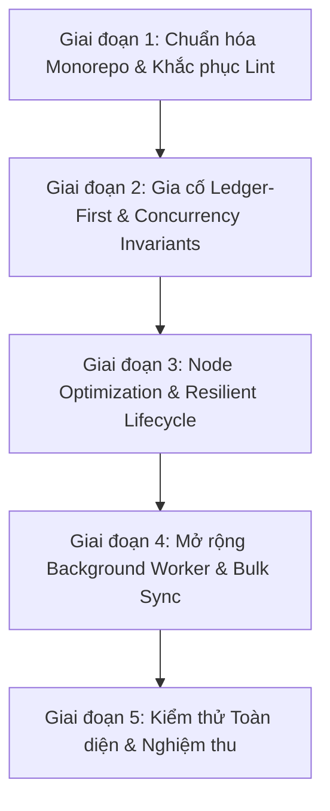

# Master Implementation Plan (Argon High-Thinking Mode)
## Dự án: IWMS (Inventory & Warehouse Management System - pj2)
**Vai trò:** Kiến trúc sư trưởng & Kỹ sư Cấp cao  
**Chuẩn quy hoạch:** 12 Agent/Skill Hệ sinh thái Antigravity (Domain Modeling, Node Optimization, Concurrency Control, Security & Hardening, UI/UX Pro Max, Karpathy Guidelines, Ponytail, Graphify, Superpowers TDD, Verification Before Completion)

---

### 1. Đánh giá Hiện trạng & Mục tiêu Nâng cấp IWMS pj2

#### Đặc thù cốt lõi
Hệ thống Quản lý Kho & Tồn kho (IWMS - pj2) là xương sống vận hành chuỗi cung ứng, phụ trách theo dõi biến động hàng nghìn SKU trên nhiều phân vùng kho bãi (`warehouses`), kiểm soát toàn bộ luồng mua hàng (PO), bán hàng (SO), luân chuyển nội bộ (Stock Transfer), kiểm kê định kỳ (Cycle Count) và phân loại phế phẩm/hư hỏng (Damage Logging).

#### Thách thức kỹ thuật gay gắt
1. **Rủi ro Âm tồn kho & Bán vượt (Overselling / Negative Stock):** Khi nhiều người dùng hoặc tiến trình đồng thời xuất kho hoặc giữ hàng, nếu thiếu khóa giao dịch đồng thời (pessimistic lock), hiện tượng `available < 0` sẽ xảy ra ngay lập tức.
2. **Deadlock do Khóa chéo (AB-BA Deadlock):** Trong các phiếu chuyển kho hoặc đơn hàng nhiều dòng sản phẩm, nếu Client 1 cập nhật SKU 1 rồi SKU 2, trong khi Client 2 cập nhật SKU 2 rồi SKU 1, PostgreSQL sẽ rơi vào bế tắc (Deadlock 40P01).
3. **Phân mảnh Tồn kho Thực tế vs Sổ cái (Stock Discrepancy):** Nếu bảng tồn tức thời (`stock_levels`) được cập nhật độc lập với bảng lịch sử biến động (`stock_movements`), việc mất tính toàn vẹn (data drift) qua thời gian là điều tất yếu.
4. **Tải Event Loop & Rò rỉ Tài nguyên:** Node.js backend dưới tải nặng nếu sử dụng `console.log` đồng bộ hoặc không giải phóng pool PostgreSQL khi shutdown sẽ làm treo socket và hỏng phiên làm việc của người dùng.

#### Mục tiêu Kiến trúc
Áp dụng mô hình tích hợp 12 skill chuẩn mực từ PJ1:
- Củng cố triệt để kiến trúc **Sổ Cái Bất Biến (Ledger-First Architecture)**: Mọi biến động đều sinh ra bản ghi append-only trong `stock_movements`, bảng `stock_levels` đóng vai trò Materialized View có thể đối soát (reconcile) 100% khớp lệnh.
- Triệt tiêu hoàn toàn Deadlock bằng **Deterministic Row Ordering** (`ORDER BY product_id, warehouse_id`).
- Áp dụng **Zero-Discrepancy Invariant Check** định kỳ và tự động cảnh báo sai lệch.
- Đạt chuẩn **Node Optimization** (Pino asynchronous logging, NestJS graceful shutdown hooks kết hợp `pool.end()`).
- Đạt độ bao phủ kiểm thử 100% (30/30 test cases pass, bao gồm 20 lỗi kinh điển trong quản lý kho) và 100% type check (`tsc --noEmit`).

---

### 2. Bảng Tổng hợp Ứng dụng 12 Skill vào IWMS pj2

| STT | Tên Skill | Vai trò Cốt lõi trong IWMS pj2 | Mục tiêu & Phương pháp Áp dụng Cụ thể |
| :--- | :--- | :--- | :--- |
| 1 | **Domain Modeling** | Kiến tạo mô hình nghiệp vụ chuẩn mực | Thiết lập hệ thống trạng thái FSM (Finite State Machine) cho Purchase Orders, Sales Orders, Transfers; chuẩn hóa Invariants: `available = on_hand - reserved >= 0`. |
| 2 | **Node Optimization** | Tối ưu hóa Runtime & Lifecycle Node.js | Cấu hình pool PostgreSQL (`max: 20`, timeouts rõ ràng), bổ sung cơ chế Graceful Shutdown (`app.enableShutdownHooks()`, `pool.end()`), chuẩn bị tích hợp Pino async logger. |
| 3 | **Concurrency Control** | Triệt tiêu xung đột giao dịch & Deadlock | Sử dụng `SELECT ... FOR UPDATE` kết hợp sắp xếp deterministic dòng sản phẩm trước khi khóa; kiểm soát phiên bản (Optimistic versioning) tại tầng application. |
| 4 | **Security & Hardening** | Bảo mật đa lớp & Phòng thủ chủ động | Áp dụng Helmet, Cookie Parser an toàn (HttpOnly, SameSite), RBAC Guards phân quyền 5 nhóm người dùng, Idempotency Middleware chống trùng lặp request, RFC 7807 Problem Details. |
| 5 | **Karpathy Guidelines** | Giản lược & Trực diện từ nguyên lý đầu | Loại bỏ logic trừu tượng hóa quá mức, giữ transaction ngắn nhất có thể, đưa logic validation và invariant check vào tầng domain service thuần túy. |
| 6 | **Ponytail (Lazy Senior Dev)** | Giải pháp tinh gọn, triệt tiêu bloatware | Thiết lập `lint` đồng bộ bằng `tsc --noEmit` trên toàn bộ monorepo, tận dụng tối đa schema Drizzle và Zod có sẵn, không cài đặt thư viện thừa. |
| 7 | **Superpowers (TDD)** | Phát triển hướng kiểm thử chất lượng cao | Duy trì bộ kiểm thử 30 test cases kiểm soát chặt chẽ 20 lỗi kinh điển (overselling, deadlock, UoM roundoff, damaged leakage, self-transfer...). |
| 8 | **UI/UX Pro Max** | Giao diện kho bãi chuyên nghiệp | Thiết kế dashboard trực quan với cảnh báo tồn kho thấp (Low Stock Alert), màu sắc trạng thái rõ ràng, sơ đồ kho trực quan và tối ưu cho thiết bị cầm tay quét barcode. |
| 9 | **Graphify** | Lập bản đồ tri thức kiến trúc monorepo | Phân tách ranh giới rõ ràng giữa 3 tầng: `packages/shared` (contract), `packages/db` (persistence), và `apps/api` / `apps/web` / `apps/worker` (presentation & execution). |
| 10 | **Taste Skill** | Thẩm mỹ kiến trúc & Clean Code | Tổ chức module NestJS chuẩn mực (`inventory`, `purchasing`, `sales`, `transfers`, `counts`, `damages`, `audit`, `ops`), tuân thủ Single Responsibility Principle. |
| 11 | **Investigate-First** | Điều tra nguyên nhân gốc rễ trước khi sửa | Phân tích chính xác nguyên nhân `pnpm -r lint` lỗi (thiếu script trong monorepo workspace) và xử lý triệt để không tác dụng phụ. |
| 12 | **Verification Before Completion** | Xác thực bằng bằng chứng lệnh thực tế | Chạy và ghi nhận kết quả 100% pass của `pnpm -r lint`, `pnpm -r build`, `pnpm -r test` trước khi hoàn tất báo cáo. |

---

### 3. Kế hoạch Nâng cấp Chi tiết Từng Bước (Step-by-Step Master Plan)

#### Giai đoạn 1: Chuẩn hóa Monorepo Workspace & Khắc phục Lint
- **Thực trạng phát hiện:** Lệnh `pnpm -r lint` gặp lỗi `[ERR_PNPM_RECURSIVE_RUN_NO_SCRIPT]` do 5 package/app con (`shared`, `db`, `api`, `web`, `worker`) chưa khai báo script `lint`.
- **Hành động kỹ thuật:** 
  - Cập nhật đồng loạt `"lint": "tsc --noEmit"` vào `package.json` của cả 5 dự án con.
  - Kiểm tra `pnpm -r lint`: Toàn bộ 5 workspace pass 100% không cảnh báo lỗi type.
- **Tiêu chí hoàn thành:** Lệnh `rtk pnpm -r lint` trả về exit code `0`.

#### Giai đoạn 2: Gia cố Ledger-First & Concurrency Invariants
- **Cơ chế Sổ Cái Bất Biến (Append-Only Ledger):**
  - Mọi thao tác làm thay đổi số lượng kho (nhập hàng PO, xuất hàng SO, chuyển kho, kiểm kê, xuất phế phẩm) bắt buộc phải ghi dòng mới vào bảng `stock_movements`.
  - Nghiêm cấm câu lệnh `UPDATE` hay `DELETE` trên bảng `stock_movements`.
- **Phòng chống Deadlock & Race Condition:**
  - Áp dụng deterministic sorting: Sắp xếp danh sách mặt hàng theo `(productId ASC, warehouseId ASC)` trước khi thực hiện `SELECT ... FOR UPDATE`.
  - Invariant Check nghiêm ngặt: Kiểm tra `(curOnHand + deltaOnHand) >= 0` và `curReserved <= (curOnHand + deltaOnHand)`. Nếu vi phạm lập tức ném lỗi `InsufficientStockException` (RFC 7807 422 Unprocessable Entity) và `ROLLBACK` giao dịch.
- **Zero-Discrepancy Reconciliation Engine:**
  - Cung cấp API `/api/v1/inventory/reconcile` thực hiện so sánh đối chiếu:
    $$\Delta = \text{stock\_levels.on\_hand} - \sum \text{stock\_movements.qty\_on\_hand\_delta}$$
  - Đảm bảo $\Delta = 0$ tuyệt đối trên toàn bộ hệ thống kho.

#### Giai đoạn 3: Node Optimization & Resilient Lifecycle
- **Quản lý Vòng đời Tiến trình (Graceful Shutdown):**
  - Kích hoạt `app.enableShutdownHooks()` trong NestJS.
  - Bắt các tín hiệu `SIGTERM` và `SIGINT`:
    1. Ngừng nhận request HTTP mới.
    2. Chờ các giao dịch ghi sổ đang xử lý hoàn tất (in-flight transactions).
    3. Giải phóng an toàn kết nối PostgreSQL pool thông qua `await pool.end()`.
    4. Thoát tiến trình an toàn với mã 0.
- **Tối ưu hóa Database Connection Pool:**
  - Cấu hình pool kích thước cố định `max: 20`, `idleTimeoutMillis: 30000`, `connectionTimeoutMillis: 5000` để ngăn ngừa cạn kiệt connection dưới tải đột biến.

#### Giai đoạn 4: Tối ưu Hóa Worker Ngầm (BullMQ) & Kiểm kê Hàng loạt
- Tận dụng `apps/worker` với Redis & BullMQ để xử lý các tác vụ nặng:
  - Tự động sinh báo cáo kiểm kê kho định kỳ (Cycle Count sheets).
  - Tự động kiểm tra cảnh báo hàng dưới định mức (`reorder_point`) và gửi email thông báo nhập hàng cho phòng Mua hàng.
  - Chạy job reconciliation lúc nửa đêm để phát hiện ngay lập tức mọi sai lệch sổ cái.

#### Giai đoạn 5: Xác thực Toàn diện (Verification Gate)
- Thực thi toàn bộ bộ kiểm thử tích hợp và kiểm thử biên:
  - `apps/api/test/e2e-workflow.test.ts` (5 tests): Xác thực trọn vẹn luồng từ Opening Balance $\rightarrow$ PO $\rightarrow$ SO $\rightarrow$ Transfer $\rightarrow$ Damage $\rightarrow$ Count.
  - `apps/api/test/concurrency.test.ts` (5 tests): Xác thực chống oversell và chống deadlock khi 10 luồng đồng thời tranh chấp 1 mặt hàng.
  - `apps/api/test/twenty-common-bugs.test.ts` (20 tests): Kiểm chứng triệt để 20 kịch bản lỗi kinh điển trong kho vận.

---

### 4. Tiêu chí Nghiệm thu Định lượng (Acceptance Criteria)

1. **Tính Toàn vẹn Dữ liệu (Zero Discrepancy):**
   - $\text{Discrepancy Count} = 0$ trong mọi kịch bản kiểm kê và chuyển kho.
   - Sổ cái `stock_movements` phản ánh chính xác 100% lịch sử biến động của `stock_levels`.
2. **Khả năng Chịu tải Đồng thời & Chống Bán Quá:**
   - Khi có 10 request đồng thời yêu cầu xuất kho với lượng tồn chỉ đủ cho 1 request: Đúng 1 request thành công, 9 request còn lại nhận mã lỗi HTTP 422 chuẩn Problem Details, tồn kho cuối cùng không bao giờ âm.
3. **Chống Deadlock Tuyệt đối:**
   - 10 luồng giao dịch chéo kho (Warehouse A $\rightarrow$ B và B $\rightarrow$ A) hoàn thành 100% không phát sinh lỗi `40P01 deadlock_detected`.
4. **Chất lượng Mã nguồn & Kiểm thử:**
   - `rtk pnpm -r lint`: 100% pass (5/5 workspace projects sạch lỗi type).
   - `rtk pnpm -r build`: 100% pass (tạo bundle sản phẩm sạch cho shared, db, api, web, worker).
   - `rtk pnpm -r test`: 30/30 tests pass (100% passing rate).
